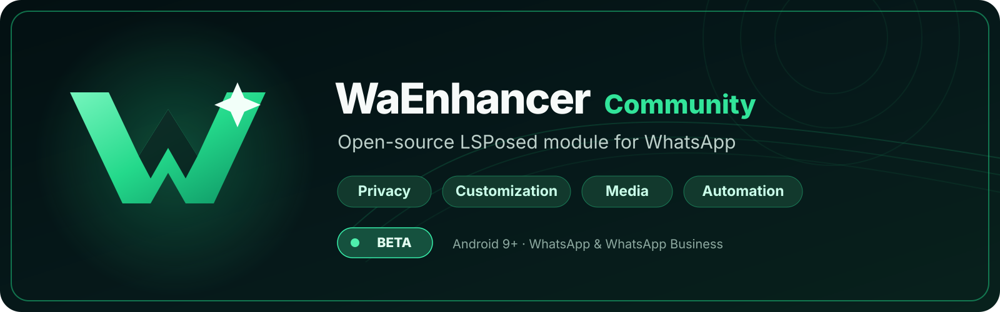

## Application-only review build

The current review removes system_server/SettingsProvider hooks, WhatsApp downgrade/update interception and optional bootloader/root spoofing. WhatsApp, WhatsApp Business and the Community settings app are the only suggested Xposed scopes. Media downloads, themes and preferences use a UID-validated direct provider bridge. This is not a claim of physical Android 17 or Wallet validation; see [the audit and test/rollback procedure](docs/APP_ONLY_REVIEW_2026-10-22.md).

Manual workflow: choose `mode=lab`, select the review branch and supply its exact `expected_sha` to produce a signed experimental Actions artifact without a public release. `mode=release` publishes only from master. Existing data and stored settings are preserved; no automatic migration deletes old spoof preferences.

  

  
  
  
  
  
  
  
  

  <strong>Privacy, customization, media tools and automation for WhatsApp — fully open source.</strong>

WaEnhancer Community is an independent **LSPosed/Xposed module for Android** that extends WhatsApp and WhatsApp Business without replacing the original apps. It adds privacy controls, interface customization, media and messaging tools, automation, and quality-of-life features, including settings that can be opened directly inside WhatsApp.

> [!IMPORTANT]
> WaEnhancer Community is not affiliated with, endorsed by, or supported by WhatsApp or Meta. WhatsApp updates can change internal APIs without notice, and using runtime modifications may carry stability or account risks.

## Project status

The project is currently in **beta-stage development**. The core Community architecture and the main feature set are in place; current work is focused on compatibility, regression testing, and polishing the public release experience.

Feature availability can vary by WhatsApp build. WaEnhancer performs runtime compatibility checks before installing core hooks, and incompatible features are isolated when possible instead of assuming that every nearby WhatsApp version is safe.

Remaining engineering work and intentionally deferred ideas are tracked in [ROADMAP.md](ROADMAP.md).

## Features

| | |
| --- | --- |
| **Privacy & control** | Anti-revoke, view-once controls, stealth read/status viewing, hide typing or recording indicators, freeze last seen, locked-chat enhancements, call and per-contact privacy controls. |
| **Customization** | Embedded settings inside WhatsApp, floating bottom bar, Liquid Glass surfaces, colors and themes, wallpapers, home-screen and tab controls, toolbar, bubble, timestamp, and status presentation options. |
| **Media & messaging** | View-once, status and profile-picture downloads, media quality options, edited/deleted message history, video-note tools, auto status forwarding, and call recording. |
| **Automation & tools** | Tasker integration, audio transcription, chat filters, pinned/share-limit controls, Quick Settings toggles, settings backup/restore, local diagnostics, and update checks. |

The app exposes many individual toggles inside each category. This README intentionally describes the major capabilities rather than duplicating the changelog.

## Media library

The optional **Media library** keeps private copies of photos and videos you choose, inside the module's own storage, so they stay available even when WhatsApp no longer has the file.

- Turn it on in **WaEnhancer → Media → Media library**, then force-stop and reopen WhatsApp.
- Open a photo or video in WhatsApp, tap **⋮ → Keep in library**. Nothing is ever kept automatically.
- In a conversation, **⋮ → Media library** shows the copies kept from that chat. Tap to view, swipe for the next one, long-press to move an item to the trash.
- When WhatsApp has lost a file that you kept, the chat shows your copy with a **Library copy** label.
- **WaEnhancer → Media → Open media library** shows everything, lets you set the storage limit, verify the files, empty the trash and make an **encrypted backup** (you choose the password and where the file goes).

- **Keep received view-once**: every view-once photo or video you receive is copied automatically while WhatsApp still has it, so when WhatsApp stops providing it (for example “Photo expired”) the chat shows your copy and opens it like a normal photo or video. This switch is on by default once the Media library is on. View-once media that already expired before you turned this on cannot be recovered.
- **Restore into WhatsApp** (experimental, off by default): if WhatsApp loses the file of a normal photo or video you kept, WaEnhancer can put your copy back where WhatsApp expects it. It writes into WhatsApp's storage and could undo a deletion you made there, so turn it on only if you want that; whether WhatsApp's own media list then shows it still has to be confirmed on a phone.
- In a contact's **Media** screen, a **View once** chip lists that contact's kept view-once photos and videos separately from normal media.
- **Save to gallery** (long-press in the library): view-once copies go to the **Pictures/View Once** album, normal media to **DCIM/WhatsApp**. The Download View Once button also saves to **Pictures/View Once**.

What it does not do: it does not keep other people's **status** posts, it does not keep normal media without your tap, it does not change your messages in WhatsApp, and it never uploads anything or adds your copies to the phone's public gallery. Copies are deleted only when you delete them (the trash empties itself after 30 days) or uninstall WaEnhancer — make an encrypted backup first if you want to keep them.

Technical details: [docs/MEDIA_LIBRARY.md](docs/MEDIA_LIBRARY.md). This feature still needs testing on real devices.

## Requirements

- **Android 9 (API 28) or newer**
- A rooted device with **LSPosed** or another compatible Xposed environment
- **WhatsApp** (`com.whatsapp`) or **WhatsApp Business** (`com.whatsapp.w4b`)
- A WhatsApp build that passes the module's compatibility checks

Because WaEnhancer hooks WhatsApp internals, compatibility is tied to the installed WhatsApp version rather than Android alone.

## Installation

1. Install and configure LSPosed on the rooted device.
2. Download the WaEnhancer Community APK from this repository's [GitHub Releases](https://github.com/igorcv88/WaEnhancerXCommunity/releases).
3. Install the APK and enable **WaEnhancer Community** in LSPosed.
4. Accept the recommended scope and make sure the WhatsApp package you use is enabled.
5. Force-stop and reopen WhatsApp, then open WaEnhancer Community to configure the features you want.

Official public binaries are distributed only through this repository. **If the Releases page is empty, there is no signed public release for that revision yet.** Avoid APK mirrors or repackaged builds.

## Compatibility

WhatsApp changes its internal classes, methods, and layouts frequently. A feature that works on one build may need to be disabled or updated on the next one.

The companion app shows validated WhatsApp versions, while the hooked process can evaluate newer WhatsApp 2.x builds at runtime before enabling the core feature loader. A successful compatibility check means the required contracts were found; it does not guarantee that every UI behavior has been regression-tested on that exact build.

When reporting a compatibility problem, include the Android version, WhatsApp version, LSPosed version, and the relevant WaEnhancer diagnostics. Do not include message contents, phone numbers, tokens, or other personal data.

## Privacy and security

The Community fork is designed to keep diagnostics local and auditable. It does not use Firebase Analytics or Crashlytics, and the executable module code is built from this repository.

For the project policies and technical model, see:

- [Privacy policy](PRIVACY.md)
- [Security policy](SECURITY.md)
- [Architecture](ARCHITECTURE.md)
- [Roadmap](ROADMAP.md)

## Contributing

Bug reports, compatibility findings, documentation improvements, and pull requests are welcome. Use the repository's [Issues](https://github.com/igorcv88/WaEnhancerXCommunity/issues) for reproducible bugs or feature proposals.

Changes that touch WhatsApp hooks should fail safely when a resolver is unavailable and should avoid turning a single incompatible feature into a process-wide failure.

## License and attribution

WaEnhancer Community is licensed under the **GNU General Public License v3.0**. See [LICENSE](LICENSE) and [NOTICE](NOTICE).

This is an independent community fork based on **WaEnhancer X**. The original source URL is preserved in [SOURCE_URL](SOURCE_URL); this project is not an official WhatsApp, Meta, or upstream-maintainer release.
